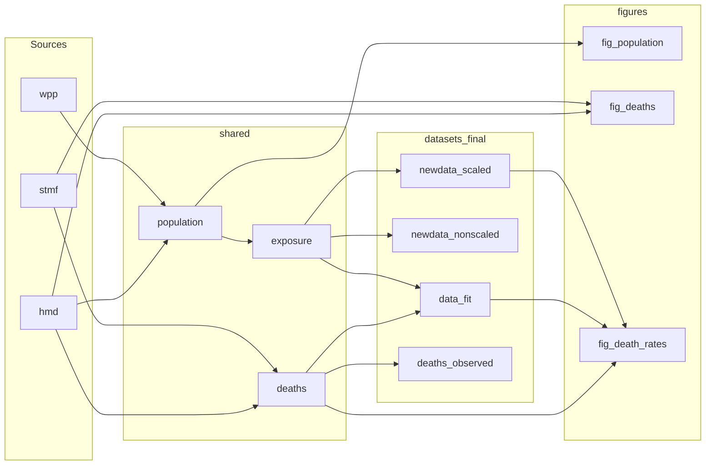

# multi-covid-data

Pipeline for assembling multi-country COVID-era mortality data from the
[Human Mortality Database](https://www.mortality.org/) (HMD), the
[Short-Term Mortality Fluctuations](https://www.mortality.org/Data/STMF)
data series (STMF), and UN World Population Prospects (WPP) population
counts. The main analysis outputs are zip files under `out/datasets_final/`
(each archive holds one CSV); PDF figures under `out/figures/` check
population, deaths, and death rates.

## Overview

- **Inputs:** country-level archives under `data/hmd/`, `data/stmf/`, and
  `data/wpp/` (Git LFS).
- **Harmonisation:** source pipelines write `out/{hmd,stmf,wpp}/`, then
  `out/shared/` combines population, deaths, and person-year exposure.
- **Analysis products:** `out/datasets_final/` holds fit-period deaths with
  exposure, COVID-period exposures (scaled and nonscaled), and observed
  COVID-period deaths.
- **Checks:** validation PDFs compare HMD vs WPP population, HMD vs STMF
  deaths, and HMD vs STMF death rates.

## Setup

1. Install [Git LFS](https://git-lfs.com/) and clone the repository (see
   [Large files (Git LFS)](#large-files-git-lfs)).
2. Install R, then restore the project library with
   [renv](https://rstudio.github.io/renv/):

```r
renv::restore()
```

3. Build everything:

```bash
make
```

## How to build

| Command | Effect |
|---------|--------|
| `make` / `make all` | Build analysis zips and validation figures |
| `make .COPY` | Copy `out/datasets_final/*.zip` to `../multi-covid-model/data/` |
| `make clean` | Delete `out/` and recreate an empty `out/` |
| `make out/path/to/target` | Rebuild one target and its dependencies |

`make all` produces:

- `out/datasets_final/data_fit.zip`
- `out/datasets_final/newdata_nonscaled.zip`
- `out/datasets_final/newdata_scaled.zip`
- `out/datasets_final/deaths_observed.zip`
- `out/figures/fig_population.pdf`
- `out/figures/fig_deaths.pdf`
- `out/figures/fig_death_rates.pdf`

Intermediate objects under `out/hmd/`, `out/stmf/`, `out/wpp/`,
`out/shared/`, and figure helpers such as `out/figures/vals_*.rds` are
built as dependencies and are not listed in `all`.

## Pipeline layout

```text
data/{hmd,stmf,wpp}/     versioned inputs (+ country CSVs)
src/{hmd,stmf,wpp}/      source extracts and cleaning
src/shared/              combined population, deaths, exposure
src/datasets_final/      analysis zips (one CSV each)
src/figures/             validation plots (+ vals_* helpers)
out/                     all derived artefacts (gitignored)
```



## Data sources

| Source | Location | Contents used |
|--------|----------|----------------|
| HMD | `data/hmd/` | Deaths, population, period life expectancy archives |
| STMF | `data/stmf/` | Weekly mortality (`STMFinput-2.zip`), aggregated to annual totals |
| WPP | `data/wpp/` | Population by single age and sex, 1 January (medium variant); counts stored in thousands |

Year windows and coverage gates are set in the [Makefile parameters](#makefile-parameters).
WPP population is restricted to HMD study countries when building shared
population; STMF fills deaths only for country–years without HMD.

### Country maps

HMD and STMF use different PopName / PopCode sets for some countries (Germany,
France, UK, New Zealand), so each has its own concordance and filtered map.
Targets should use the same study codes (typically ISO3). WPP is not filtered
by country at extract time; shared population keeps WPP rows for HMD study
countries only.

| file | role |
|------|------|
| `data/hmd/countries.csv` | HMD PopName → study code (hand-edited) |
| `data/stmf/countries.csv` | STMF PopCode → study code (hand-edited) |
| `out/hmd/countries.rds` | Filtered HMD source → target map |
| `out/stmf/countries.rds` | Filtered STMF source → target map |

`src/hmd/countries.R` applies `data/hmd/countries.csv` and `YEAR_REQUIRED_HMD`,
and writes `out/hmd/countries.rds`. HMD deaths / population / lifeexp use that
map only.

`src/stmf/countries.R` applies `data/stmf/countries.csv` and keeps sources with
week coverage through `WEEK_REQUIRED_STMF` of `YEAR_REQUIRED_STMF`, writing
`out/stmf/countries.rds`. STMF deaths use that map only (plus a year window).

#### Columns (`countries.csv`)

| column   | meaning                                      |
|----------|----------------------------------------------|
| `source` | Source PopName / PopCode (must be unique)    |
| `target` | Study country code after keep / rename / merge |

#### Interpretation

- **Keep** — `target` equals `source` (e.g. `AUS`,`AUS`).
- **Rename** — `target` is a different non-empty code (e.g. `FRATNP`,`FRA`).
- **Merge** — two or more rows share the same non-empty `target` (e.g. HMD
  `DEUTE` and `DEUTW` both → `DEU`).
- **Drop** — `target` is empty (blank cell). That source is excluded.

Only rows with a non-empty `target` are kept. For HMD, targets whose last
observed year in deaths is before `YEAR_REQUIRED_HMD` are also dropped. For
STMF, sources lacking the required week in the required year are dropped.

## Shared series

Built under `out/shared/` from the cleaned source pipelines.

**Population** (`population.rds`) — Prefer HMD counts; fill missing
country–year–sex–age cells with WPP × 1000. Also store a WPP series scaled to
the latest overlapping HMD level by country–sex–age
(`population_nonscaled` / `population_scaled`, plus source flags).

**Deaths** (`deaths.rds`) — Prefer HMD for each country–year. Where HMD is
absent, use STMF for that year, choosing the finest complete age partition
with an open terminal group (validated with `agetime`). Column `source` is
`hmd` or `stmf`. Age labels can differ across country–years.

**Exposure** (`exposure.rds`) — Mid-year person-years
`0.5 * (pop_t + pop_{t+1})` for both nonscaled and scaled population series,
only where consecutive years exist. The last population year (2026) therefore
has no exposure row.

## Analysis products

Files in `out/datasets_final/` (the modelling-facing deliverables; each `.zip`
contains one CSV that `readr::read_csv()` can read directly):

| file | Years | Columns | Notes |
|------|-------|---------|--------|
| `data_fit.zip` | `< 2020` | `country`, `year`, `sex`, `age`, `deaths`, `exposure` | Deaths joined to nonscaled exposure; deaths rounded |
| `newdata_nonscaled.zip` | `≥ 2020` | `country`, `year`, `sex`, `age`, `exposure` | From `exposure_nonscaled` |
| `newdata_scaled.zip` | `≥ 2020` | `country`, `year`, `sex`, `age`, `exposure` | From `exposure_scaled` |
| `deaths_observed.zip` | `≥ 2020` | `country`, `year`, `sex`, `age`, `deaths` | From shared deaths (HMD preferred, else STMF) |

## Validation figures

| PDF | Checks |
|-----|--------|
| `fig_population.pdf` | HMD vs WPP population by country–sex, age facets, from `YEAR_MIN_WPP` |
| `fig_deaths.pdf` | HMD vs STMF death counts (HMD coarsened to STMF ages), from `YEAR_MIN_WPP` |
| `fig_death_rates.pdf` | HMD vs STMF rates using scaled exposure (`data_fit` before 2020, `newdata_scaled` from 2020) |

Figure-only intermediates live under `out/figures/` as `vals_population.rds`
and `vals_deaths.rds`. They are not part of `datasets_final`.

## Makefile parameters

| Variable | Default | Role |
|----------|---------|------|
| `YEAR_MIN` | 1970 | Lower bound for shared deaths / population assembly |
| `YEAR_MAX` | 2025 | (Reserved; shared deaths use `YEAR_MAX_STMF`) |
| `YEAR_REQUIRED_HMD` | 2019 | HMD country kept only if last deaths year ≥ this |
| `YEAR_MIN_WPP` | 2000 | WPP estimate extract start; population figure `year_min` |
| `YEAR_MAX_WPP` | 2026 | WPP projection extract end; shared population upper year |
| `YEAR_REQUIRED_STMF` | 2025 | STMF country must have data in this year |
| `WEEK_REQUIRED_STMF` | 52 | …through at least this week |
| `YEAR_MIN_STMF` | 2020 | Processed STMF deaths lower year |
| `YEAR_MAX_STMF` | 2025 | Processed STMF / shared deaths upper year |

## Excluded countries

**Israel (`ISR`)** is listed in both `data/hmd/countries.csv` and
`data/stmf/countries.csv`, and STMF supplies annual deaths for 2020–2025.
HMD deaths for ISR, however, end in **2016**, which is before
`YEAR_REQUIRED_HMD` (2019). ISR is therefore dropped from
`out/hmd/countries.rds` and never enters HMD deaths or population.

Shared population (and thus exposure and `datasets_final`) is restricted to
HMD study countries, so ISR also has no scaled exposure for rate figures.
By contrast, Greece (`GRC`) and Slovenia (`SVN`) pass the 2019 HMD gate
(HMD deaths through 2019) and are included even though their HMD series stop
before 2020.

## Data corrections

Corrections applied when reading source files (inputs under `data/` are left
unchanged):

| Source | Scope | Issue | Fix |
|--------|-------|-------|-----|
| STMF | `DEUTNP`, Female, 2025, Age `95` | All weeks use `AgeInterval = "5"` (labelled `95-99`) while males and both-sex use `"+"` (`95+`) | In `src/stmf/deaths_raw.R`, remap that interval to `"+"` before building age labels |

## Large files (Git LFS)

Archives under `data/` (HMD, STMF, and WPP inputs) are stored with
[Git LFS](https://git-lfs.com/). A normal `git clone` with Git LFS installed
downloads them automatically (currently about **170 MB** total). To clone the
code without those payloads:

```bash
GIT_LFS_SKIP_SMUDGE=1 git clone https://github.com/bayesiandemography/multi-covid-data.git
```

Then fetch the data later with `git lfs pull` if needed. Without Git LFS, those
paths appear as small pointer files rather than the real archives.
