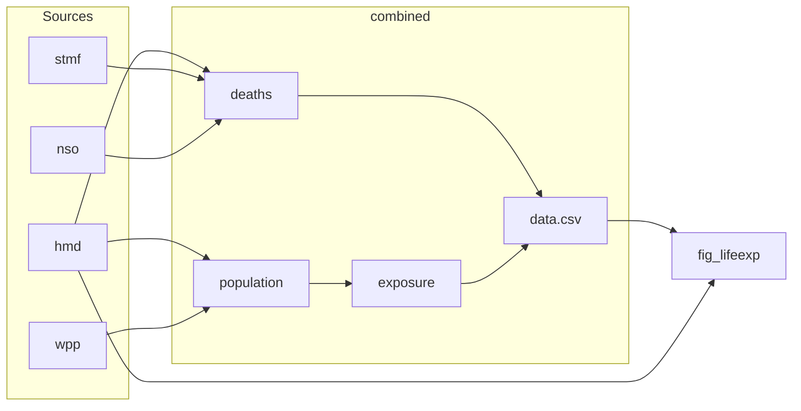

# multi-covid-data

Pipeline for assembling multi-country COVID-era mortality data from the
[Human Mortality Database](https://www.mortality.org/) (HMD), the
[Short-Term Mortality Fluctuations](https://www.mortality.org/Data/STMF)
data series (STMF), and UN World Population Prospects (WPP) population
counts. The main analysis output is `out/data.csv.zip` (the archive holds
one CSV). `out/fig_lifeexp.pdf` compares life expectancy at birth with the
Human Mortality Database.

## Overview

- **Inputs:** country-level archives under `data/hmd/`, `data/stmf/`, and
  `data/wpp/` (Git LFS).
- **Harmonisation:** source pipelines write `out/{hmd,stmf,wpp}/`, then
  population, deaths, and person-year exposure are written under
  `out/intermediate/`.
- **Analysis product:** `out/data.csv.zip` holds deaths and scaled exposure
  for every year, with source flags.
- **Check:** `out/fig_lifeexp.pdf` compares life expectancy at birth from
  `data.csv` with the Human Mortality Database.

## Setup

1. Install [Git LFS](https://git-lfs.com/) and clone the repository (see
   [Large files (Git LFS)](#large-files-git-lfs)).
2. Install R, then restore the project library with
   [renv](https://rstudio.github.io/renv/):

```r
renv::restore()
```

3. Build everything:

```bash
make
```

## How to build

| Command | Effect |
|---------|--------|
| `make` / `make all` | Build `out/data.csv.zip` and `out/fig_lifeexp.pdf` |
| `make .COPY` | Copy `out/data.csv.zip` to `../multi-covid-model/data/` |
| `make clean` | Delete `out/` and recreate an empty `out/` |
| `make out/path/to/target` | Rebuild one target and its dependencies |

`make all` produces:

- `out/data.csv.zip`
- `out/fig_lifeexp.pdf`

Intermediate objects under `out/hmd/`, `out/stmf/`, `out/wpp/`, `out/nso/`,
and `out/intermediate/` are built as dependencies and are not listed in `all`.
`out/intermediate/` holds `population.rds`, `deaths.rds`, `exposure.rds`, and
`vals_lifeexp.rds`.

## Pipeline layout

```text
data/{hmd,stmf,wpp,nso}/          versioned inputs (+ country CSVs)
src/data.R                        out/data.csv.zip
src/fig_lifeexp.R                 out/fig_lifeexp.pdf
src/{hmd,stmf,wpp,nso}/           out/{hmd,stmf,wpp,nso}/
src/intermediate/                 out/intermediate/
```

`out/` holds the derived artefacts and is gitignored. Its directories match `src/`.



## Data sources

| Source | Location | Contents used |
|--------|----------|----------------|
| HMD | `data/hmd/` | Deaths, population, period life expectancy archives |
| STMF | `data/stmf/` | Weekly mortality (`STMFinput-2.zip`), aggregated to annual totals |
| WPP | `data/wpp/` | Population by single age and sex, 1 January (medium variant); counts stored in thousands |

The year window is set in the [Makefile parameters](#makefile-parameters).
WPP population is restricted to HMD study countries when building combined
population. For each country–year, deaths come from HMD, then STMF, then NSO.

### Country maps

HMD and STMF use different PopName / PopCode sets for some countries (Germany,
France, UK, New Zealand), so each has its own concordance and filtered map.
Targets should use the same study codes (typically ISO3). WPP is not filtered
by country at extract time; combined population keeps WPP rows for HMD study
countries only.

| file | role |
|------|------|
| `data/hmd/countries.csv` | HMD PopName → study code (hand-edited) |
| `data/stmf/countries.csv` | STMF PopCode → study code (hand-edited) |
| `out/hmd/countries.rds` | Filtered HMD source → target map |
| `out/stmf/countries.rds` | Filtered STMF source → target map |

`src/hmd/countries.R` applies `data/hmd/countries.csv` and writes
`out/hmd/countries.rds`. HMD deaths / population / lifeexp use that map only.

`src/stmf/countries.R` applies `data/stmf/countries.csv` and keeps sources with
week coverage through `WEEK_REQUIRED_STMF` of `YEAR_MAX`, writing
`out/stmf/countries.rds`. STMF deaths use that map only, within `YEAR_MIN` to
`YEAR_MAX`.

#### Columns (`countries.csv`)

| column   | meaning                                      |
|----------|----------------------------------------------|
| `source` | Source PopName / PopCode (must be unique)    |
| `target` | Study country code after keep / rename / merge |

#### Interpretation

- **Keep** — `target` equals `source` (e.g. `AUS`,`AUS`).
- **Rename** — `target` is a different non-empty code (e.g. `FRATNP`,`FRA`).
- **Merge** — two or more rows share the same non-empty `target` (e.g. HMD
  `DEUTE` and `DEUTW` both → `DEU`).
- **Drop** — `target` is empty (blank cell). That source is excluded. Belarus (`BLR`), Russia (`RUS`), Ukraine (`UKR`), and Israel (`ISR`) are blank for the reasons in [Excluded countries](#excluded-countries).

Only rows with a non-empty `target` are kept. For STMF, sources lacking week
`WEEK_REQUIRED_STMF` of `YEAR_MAX` are also dropped.

## Combined series

Built under `out/intermediate/` from the cleaned source pipelines.

**Population** (`population.rds`) — Prefer HMD counts. Where HMD is missing,
use WPP × 1000 scaled to the latest overlapping HMD level by country–sex–age.
`count_hmd` and `count_wpp` keep the unscaled source counts (WPP already
converted from thousands). `population` is the scaled series. `source` is
`hmd` or `wpp` for that 1 January stock.

**Deaths** (`deaths.rds`) — For each country–year, use the first source that
has it: HMD, then STMF, then NSO. STMF keeps the published age partition
after dropping totals, subtotals, and a closed group that overlaps an open
group (validated with `agetime`). NSO keeps the published ages of male and
female only. A later source does not fill a sex or age inside a year an
earlier source already covers. Column `source` is `hmd`, `stmf`, or `nso`.
Counts are not rounded here.

**Exposure** (`exposure.rds`) — Mid-year person-years
`0.5 * (pop_t + pop_{t+1})` from the scaled population, only where consecutive
years exist. `population_source` is `hmd` when both 1 January stocks are HMD,
`wpp` when both are WPP, `mixed` when both are present and differ, and missing
when either endpoint has no source. The last population year (2026) therefore
has no exposure row.

## Analysis product

The principles used to construct this file are in
[docs/data.md](docs/data.md).

`out/data.csv.zip` is the modelling-facing deliverable. The archive contains
one CSV, `data.csv`, that `readr::read_csv()` can read directly. It is a full
join of deaths and exposure on `country`, `year`, `sex`, and `age`, so a row
is kept when either series is present.

| file | Years | Columns | Notes |
|------|-------|---------|--------|
| `data.csv.zip` | All years in deaths or exposure | `country`, `year`, `sex`, `age`, `deaths`, `exposure`, `deaths_source`, `population_source` | Deaths rounded in every year. Exposure is the scaled series. `deaths_source` is `hmd`, `stmf`, or `nso` (missing when the row has no deaths). `population_source` is `hmd`, `wpp`, or `mixed` (missing when the row has no exposure). |

## Validation figures

| PDF | Checks |
|-----|--------|
| `out/fig_lifeexp.pdf` | HMD period life expectancy at birth vs `lifeexp()` applied to `data.csv`, for country–year–sex series with ages 0, 1–4, and five-year groups through an open age of 80 or older |

The values behind the figure are in `out/intermediate/vals_lifeexp.rds`. They are not part of `data.csv.zip`.

## Makefile parameters

| Variable | Default | Role |
|----------|---------|------|
| `YEAR_MIN` | 1960 | First year for deaths, population, exposure, and the source extracts that feed them |
| `YEAR_MAX` | 2025 | Last year for deaths and exposure. STMF countries must include this year |
| `YEAR_MAX_POPULATION` | 2026 | Derived as `YEAR_MAX + 1`. Last 1 January population, from WPP projections and the combined population |
| `WEEK_REQUIRED_STMF` | 52 | STMF country must reach this week of `YEAR_MAX` |

## Excluded countries

Belarus (`BLR`), Russia (`RUS`), Ukraine (`UKR`), and Israel (`ISR`) are excluded from the study. The exclusion is a blank `target` in [`data/hmd/countries.csv`](data/hmd/countries.csv). Russia and Israel are also blank in [`data/stmf/countries.csv`](data/stmf/countries.csv). Belarus and Ukraine are not in the STMF concordance. A blank cell is easy to miss, so the reasons are written here and in [docs/data.md](docs/data.md).

Belarus, Russia, and Ukraine are excluded because there is no detailed, reliable death data for 2024 and 2025, including from the national statistical agencies. HMD deaths end in 2018 for Belarus, 2014 for Russia, and 2013 for Ukraine.

Israel is excluded because its national deaths for 2017 onwards come as two separate series: one with age detail, and one with sex detail. There is no series with both. HMD deaths end in 2016. The national file is therefore not used, and Israel is left out of the calculations.

Greece (`GRC`) and Slovenia (`SVN`) stay in the study. HMD deaths for both end in 2019. Combined population, exposure, and `data.csv.zip` include only countries that remain in the HMD study list.

## Data corrections

Corrections applied when reading source files (inputs under `data/` are left
unchanged):

| Source | Scope | Issue | Fix |
|--------|-------|-------|-----|
| STMF | `DEUTNP`, Female, 2025, Age `95` | All weeks use `AgeInterval = "5"` (labelled `95-99`) while males and both-sex use `"+"` (`95+`) | In `src/stmf/deaths_raw.R`, remap that interval to `"+"` before building age labels |

## Large files (Git LFS)

Archives under `data/` (HMD, STMF, and WPP inputs) are stored with
[Git LFS](https://git-lfs.com/). A normal `git clone` with Git LFS installed
downloads them automatically (currently about **170 MB** total). To clone the
code without those payloads:

```bash
GIT_LFS_SKIP_SMUDGE=1 git clone https://github.com/bayesiandemography/multi-covid-data.git
```

Then fetch the data later with `git lfs pull` if needed. Without Git LFS, those
paths appear as small pointer files rather than the real archives.
